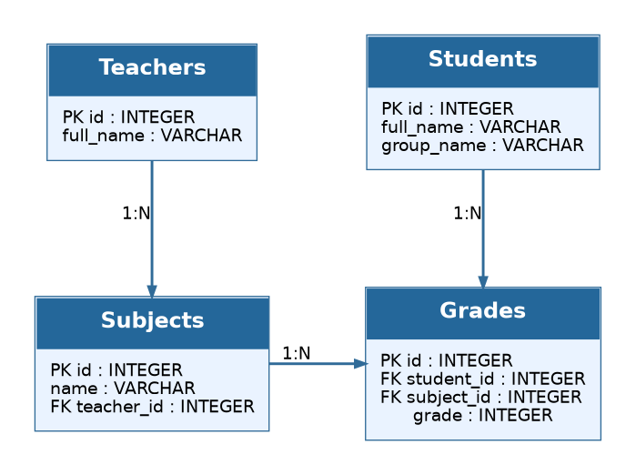

# applied-is-project-2026
## ER-диаграмма



## Лабораторная работа №2: реляционная БД и ORM

Тема ИС: учет успеваемости студентов. Реализованы все четыре сущности ER-диаграммы:

| Таблица | Поля | Связи |
| --- | --- | --- |
| `teachers` | `id`, `full_name` | Один преподаватель — много предметов |
| `students` | `id`, `full_name`, `group_name` | Один студент — много оценок |
| `subjects` | `id`, `name`, `teacher_id` | Один предмет — много оценок; принадлежит преподавателю |
| `grades` | `id`, `student_id`, `subject_id`, `grade` | Связывает студентов и предметы, хранит оценку |

### Файлы

- `backend/models/models.py` — модели `Teacher`, `Student`, `Subject`, `Grade`, первичные и внешние ключи, объектные связи.
- `backend/models/__init__.py` — экспорт всех моделей и регистрация их таблиц при импорте пакета.
- `backend/models/student.py` — сохраненный путь импорта `Student` из ЛР №1.
- `backend/db.py` — подключение SQLite, `PRAGMA foreign_keys=ON`, `init_db()` и `get_session()`. Параметр `echo=True` выводит SQL-запросы в консоль.
- `backend/database.py` — сохраненные имена импортов из ЛР №1, использующие новое подключение.
- `backend/main.py` — приложение FastAPI, создающее таблицы при запуске.
- `backend/api/routes.py` — маршрут `GET /` для проверки API.
- `frontend/app.py` — интерфейс Streamlit с кнопкой проверки доступности API.
- `seed.py` — создание схемы и добавление тестовых данных без дубликатов при повторном запуске.
- `tests/test_database.py` — семь проверок схемы, данных, связей, ограничений и запуска API; временные тестовые базы не затрагивают рабочую БД.
- `requirements.txt` — зависимости проекта.
- `.gitignore` — исключение виртуального окружения, локальных БД и журналов SQLite из Git.
- `ER_diagram.png` — схема из первой лабораторной работы.
- `LAB2.md` — пояснения к реализации и ответы на контрольные вопросы.

### Запуск из корня репозитория

Требуется Python 3.10 или новее. Для нового окружения:

```powershell
python -m venv .venv
.\.venv\Scripts\python.exe -m pip install -r requirements.txt
```

Создание и наполнение БД:

```powershell
.\.venv\Scripts\python.exe seed.py
```

В корне репозитория появится `database.db`. Результат для новой базы: 3 преподавателя, 3 студента, 3 предмета, 5 оценок. В консоли выводятся `CREATE TABLE`, `INSERT` и количество записей. Повторный запуск сохраняет эти количества и не удаляет существующие данные.

Тесты:

```powershell
.\.venv\Scripts\python.exe -m unittest discover -s tests -v
```

Запустите backend и frontend в двух отдельных терминалах:

```powershell
.\.venv\Scripts\python.exe -m uvicorn backend.main:app --reload
```

```powershell
.\.venv\Scripts\python.exe -m streamlit run frontend/app.py
```

API: http://127.0.0.1:8000/; Swagger UI: http://127.0.0.1:8000/docs; Streamlit: http://localhost:8501.

Оценки хранятся по выбранной для примера шкале от 0 до 100. Для одного студента по одному предмету допустимо несколько оценок. Списки `student.subjects` и `subject.students` доступны для чтения; новую связь с оценкой нужно создавать через `Grade`.

База `backend/db.sqlite3` из ЛР №1, если она есть, сохраняется без изменений и больше не используется. Перенос ее данных в новую схему не выполняется. `init_db()` создает отсутствующие таблицы, но не заменяет миграции при дальнейшем изменении структуры уже существующих таблиц.
